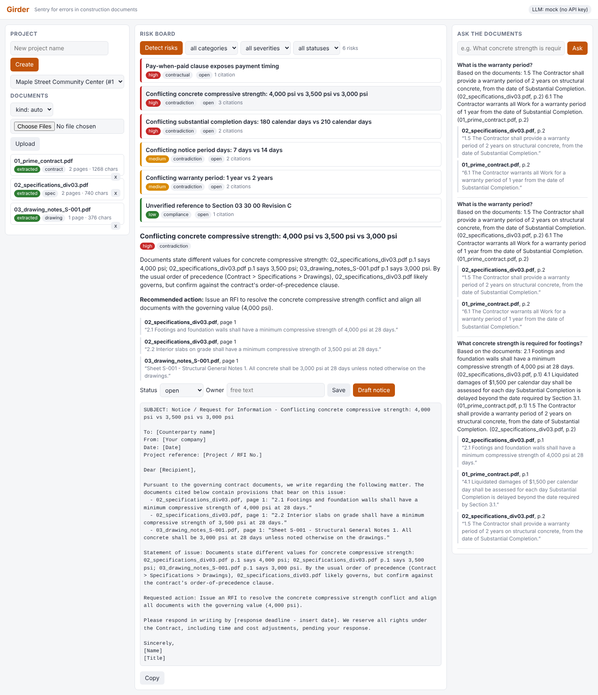

# Girder - a working clone of Telamont (YC F26)

Original company: **Telamont** - "Sentry for errors in construction documents."
Site: https://telamont.com - YC page: https://www.ycombinator.com/companies/telamont



## What Telamont does

Telamont ingests a construction project's documents (contracts, subcontracts, specifications, drawing notes, schedules, addenda), reads them *together*, and flags technical, contractual and compliance risks, especially contradictions between documents, before they become RFIs, change orders or disputes. Every finding cites the clause/page it came from. Teams triage risks on a board, ask an AI agent questions about the documents, and draft formal notices / RFIs from the governing clause. The real product also integrates with Procore, Autodesk, SharePoint and similar systems.

## What Girder does (and skips)

Girder implements the core loop for one project at a time, locally:

1. Create a project; upload PDF / TXT / MD files (extracted page by page, chunked on paragraph boundaries, never across pages). Scanned PDFs are reported as `failed` with a clear message.
2. **Detect risks** with a two-stage LLM pipeline; each risk has category, severity, description, recommendation and verbatim citations (document, page, quote). Contradictions cite 2+ documents.
3. **Risk board**: filter by category/severity/status; open a risk; set owner; status `open -> in_review -> resolved | dismissed`.
4. **Ask**: BM25 retrieval (top 6 chunks) + LLM that answers only from them, with citations; shows "No basis found in the documents." otherwise. History is persisted.
5. **Draft notice**: formal letter/RFI from a risk's citations, with a Copy button.

Skipped (per spec): auth, billing, teams, Procore/Autodesk/SharePoint/Box/Dropbox/Slack/Outlook integrations, voice, drawing/image understanding, revision re-sync, email sending, SOC2.

## Architecture

```
app/main.py       FastAPI routes + static UI mount (/api/*, /)
app/db.py         SQLModel engine/session (SQLite)
app/models.py     Project, Document, Chunk, Risk, Citation, Question
app/extract.py    pypdf / text extraction, kind guessing, page-bounded chunking (1200-1800 chars)
app/retrieval.py  rank-bm25 index per project, cached in memory, invalidated on upload/delete
app/llm.py        provider abstraction: AnthropicProvider (+JSON parsing/retry) and provider selection
app/mock_llm.py   deterministic mock provider (keyword->topic table, rule-based contradictions)
app/pipeline.py   two-stage detection, ask, notice
app/static/index.html  dependency-free vanilla JS/CSS UI (works offline)
```

**Detection pipeline.**
- *Stage 1 (per document)*: chunks are batched into windows of <= 12k chars. The LLM returns `requirements` cards (`topic`, `value`, `clause_ref`, `page`, `quote`, `kind`) and `single_doc_risks`. Held in memory only.
- *Stage 2 (cross-document, one call)*: cards for topics that appear in 2+ documents are sent as compact JSON; the LLM returns contradictions with >= 2 citations from >= 2 documents and which document likely governs. If the cards exceed ~60k chars they are grouped by topic and compared in batches.
- Merge, dedupe by (title, first citation), map citations to `Document` rows by filename, persist. Re-running replaces `open` risks and keeps `in_review`/`resolved`/`dismissed` ones (matching titles are not recreated).

**Mock provider** (no API key): Stage 1 scans sentences against a keyword/regex table (psi, calendar days, notice+days, liquidated damages, retainage, warranty, air entrainment, submittals) and flags pay-when-paid / unlimited / time-is-of-the-essence-without-notice / unverified spec revisions; Stage 2 emits a contradiction whenever a topic has differing normalized values across documents (e.g. "2 years" == "24 months"); Ask returns the best sentences of the top-3 chunks; Notice fills a letter template.

## GitHub tools used

| Library | Repo | Used for |
|---|---|---|
| fastapi | https://github.com/fastapi/fastapi | HTTP API + static UI |
| uvicorn | https://github.com/Kludex/uvicorn | ASGI server |
| sqlmodel | https://github.com/fastapi/sqlmodel | ORM + SQLite |
| pypdf | https://github.com/py-pdf/pypdf | PDF text extraction |
| rank-bm25 | https://github.com/dorianbrown/rank_bm25 | lexical retrieval for Ask |
| anthropic | https://github.com/anthropics/anthropic-sdk-python | LLM calls (Messages API) |
| reportlab | https://pypi.org/project/reportlab/ | sample PDF generation (dev script) |
| python-multipart | https://github.com/Kludex/python-multipart | file uploads |
| python-dotenv | https://github.com/theskumar/python-dotenv | optional `.env` loading |
| pytest + httpx | - | tests via FastAPI TestClient |

## Setup and run

```bash
cd 2026-10-30-telamont
python3 -m venv .venv
. .venv/bin/activate
pip install -r requirements.txt
python scripts/make_sample_docs.py      # writes sample_docs/*.pdf (already committed)
pytest -q                               # 25 tests, all in mock mode
cp .env.example .env                    # optional; leave ANTHROPIC_API_KEY empty for mock mode
uvicorn app.main:app --port 8000        # open http://localhost:8000
```

Demo: create a project, upload the three PDFs in `sample_docs/`, click **Detect risks** (finds strength, completion, notice-period and warranty contradictions, pay-when-paid, and an unverified spec revision), open a risk, **Draft notice**, and ask "What concrete strength is required for footings?".

Curl flow:
```bash
curl -X POST localhost:8000/api/projects -H 'content-type: application/json' -d '{"name":"Maple"}'
curl -X POST localhost:8000/api/projects/1/documents -F files=@sample_docs/01_prime_contract.pdf -F files=@sample_docs/02_specifications_div03.pdf -F files=@sample_docs/03_drawing_notes_S-001.pdf
curl -X POST localhost:8000/api/projects/1/detect
curl -X PATCH localhost:8000/api/risks/1 -H 'content-type: application/json' -d '{"status":"in_review"}'
curl -X POST localhost:8000/api/projects/1/ask -H 'content-type: application/json' -d '{"question":"What concrete strength is required for footings?"}'
curl -X POST localhost:8000/api/risks/1/notice
```

## Environment variables

| Var | Default | Notes |
|---|---|---|
| `ANTHROPIC_API_KEY` | empty | empty = mock mode under `auto` |
| `ANTHROPIC_MODEL` | `claude-sonnet-5-5` | |
| `LLM_PROVIDER` | `auto` | `auto` (anthropic if key set, else mock) / `anthropic` / `mock`. `anthropic` without a key makes LLM endpoints return HTTP 400 with a clear message; `/api/health` still works |
| `DATABASE_URL` | `sqlite:///./data/girder.db` | |
| `UPLOAD_DIR` | `./data/uploads` | |
| `PORT` | `8000` | informational; pass `--port` to uvicorn |

## Known limitations

- The Anthropic provider is fully implemented and unit-tested with a monkeypatched client, but was **never run against the live API** (no key available when building).
- Text-only PDFs; scanned/image PDFs and drawings are not understood (marked `failed`).
- Lexical (BM25) retrieval only; no semantic matching, so paraphrased questions can miss.
- Mock provider is rule-based and tuned to the sample documents; it will miss most real-world conflicts and can flag differing values that are not truly in conflict (e.g. footing vs slab strength).
- Single user, no auth; synchronous processing (large uploads/detection block the request); no migrations (schema created with `create_all`, added `Document.message` field beyond the spec).
- Quotes returned by a real LLM are not verified against source text.

## Assumptions

- "Auto-generated risks" = all risks; re-detect replaces only `open` ones.
- TXT/MD files are a single page (form feed splits pages).
- Dates are stored timezone-aware (UTC), required by current SQLModel/SQLAlchemy.
- Contradictions with fewer than 2 distinct documents after citation mapping are dropped.

## Next 3 things to build

1. Drawing/vision support for sheets (OCR + vision model for scanned PDFs, schedules and drawing callouts).
2. Revision diffing: upload addenda/new revisions and surface only what changed and which risks it creates or resolves.
3. Procore (and Autodesk) webhook sync so documents and revisions flow in automatically.
